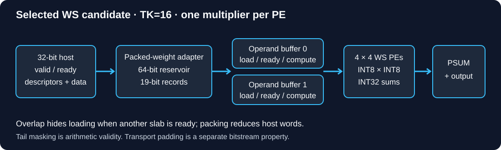
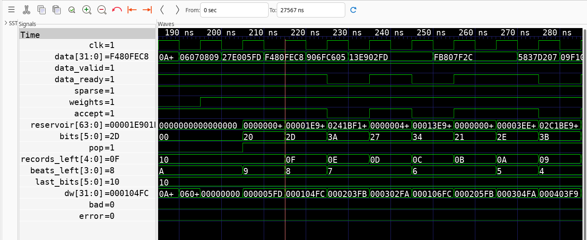

# INT8 structured-sparse GEMM: weight-stationary RTL and UVM

A synthesizable 4×4 weight-stationary (WS) accelerator for **INT8 2:4 structured sparsity**, with a 32-bit host interface, double buffering and packed sparse-weight transport. Independent Python models, SystemVerilog UVM checks and Nangate45 physical results accompany the design.

The repository includes the selected WS implementation, baseline architecture controls and reproducible verification scripts. Reported measurements are linked to saved run IDs.



## What was built

- **16 signed INT8 multipliers:** one per PE; INT16 products and INT32 partial sums.
- **Two sparse phases / four dense phases:** both operate on the same already-pruned weight matrix for fair comparisons.
- **Two operand buffers:** load a following K slab while the current slab computes; preserve ordered descriptor ownership.
- **19-bit sparse records over a 32-bit bus:** two INT8 values plus a 3-bit position code; the unpacker handles records crossing word boundaries.
- **Real Accellera UVM:** accepted-input monitoring, coordinate-based per-PE checking, final outputs, negative/recovery cases and witnessed functional coverage.

The selected implementation fixes `TK=16`, original bank mapping and the existing PSUM organization. Two multipliers per PE and PSUM redesign are deferred.

## Measured results

| Measurement | Frozen G5 WS baseline | G6 integrated candidate |
|---|---:|---:|
| Directed sparse GEMM, M=2 / K=768 / N=2, no stalls | 2,982 cycles | **2,184 cycles** |
| Host transfers for that case | 768 × 32-bit words | **624 × 32-bit words** |
| Routed standard-cell area | 132,540 µm² | 170,487 µm² |
| Fixed-layout setup slack at 5 ns | +2.321 ns | +2.124 ns |
| Fixed-layout hold slack at 5 ns | +0.0205 ns | +0.0119 ns |

For this directed case: **26.76% fewer cycles and 18.75% fewer host words**, at **28.63% more routed cell area**. Small single-slab cases can take one extra cycle. Area/timing use Nangate45 typical libraries, 35% initial utilization and a 20 ns implementation target, followed by a 5 ns audit of the unchanged layout. This is not a universal speedup or an Fmax measurement.

Historical full UVM evidence records 242 declared coverage goals, 857,088 product checks and 857,088 accumulator checks per normal regression run. A deliberately corrupted input is rejected even when UVM termination returns process status zero. See [verification scope](docs/VERIFICATION.md) and [evidence and limitations](docs/RESULTS.md).



*Actual GTKWave capture from the short UVM demonstration. The reservoir accepts 32-bit words and consumes 19-bit records; packing reduces transfers, not numerical zero multiplications. Screenshot provenance is recorded in `evidence/asset_provenance.json`.*

## Run it

Install Python 3.12 with the test dependencies, plus the external tools for the target you want. See [tool versions and complete commands](docs/REPRODUCING.md).

```bash
python3 -m venv .venv
. .venv/bin/activate
python -m pip install -r requirements.txt
python scripts/run.py unit       # Python model and strict-verdict tests
python scripts/run.py compare    # Icarus: baseline/candidate, exact saved metrics
export UVM_HOME=/absolute/path/to/1800.2-2020.3.2
python scripts/run.py uvm        # Verilator: full selected-candidate UVM gate
python scripts/run.py synth      # Yosys: generic synthesis and 16-PE check
```

After setting up the dependencies, `bash scripts/reproduce.sh` runs the supported unit → directed comparison → UVM → synthesis sequence and stops on failure.

Each hardware attempt creates a new ignored `results/<run-id>/` with source hashes, commands, logs and a manifest. Do not infer PASS from a generated file alone.

## Repository map

| Directory | Contents |
|---|---|
| `rtl/ws_integrated/` | Selected controller and packed transport adapter |
| `rtl/sparse_ws/`, `rtl/wrapper/` | WS array, baseline and historical control wrappers |
| `rtl/dense_os/`, `rtl/sparse_os/` | Dense and grouped output-stationary controls |
| `rtl/physical/` | Alternative physical tops; compile **one** top at a time |
| `verification/uvm/` | UVM tests; selected test is `ws_integrated_tb.sv` |
| `verification/directed/`, `verification/demos/` | Matched measurements and short waveform test |
| `model/`, `tests/`, `datasets/` | Independent models, unit tests and replayable model-study inputs |
| `scripts/` | Portable execution, verdict and physical-flow entry points |
| `evidence/` | Small retained historical results and public-copy validation |
| `docs/`, `assets/` | Concise public explanation and actual demonstration images |

Start with [architecture and interface](docs/ARCHITECTURE.md), then [verification](docs/VERIFICATION.md). Earlier OS/RS files are retained as comparison sources; the supported public UVM gate targets the selected integrated WS candidate. Private learning guides, tool installations, generated executables, GDS and long run trees are intentionally excluded.

## Scope and attribution

This repository models GEMM blocks, not an end-to-end CNN or transformer network. Inputs are directed/seeded integer matrices with explicitly encoded 2:4 weights. No pruning-accuracy, power, SDF simulation or foundry signoff result is claimed. Accellera UVM, Verilator, Yosys, OpenROAD-flow-scripts, Nangate45, GTKWave and other external tools retain their own licenses and are not vendored here. Project source is released under the [MIT license](LICENSE).
