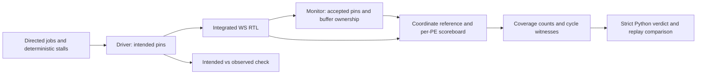

# Verification scope

The selected test is a real `uvm_test`, registered with the UVM factory and connected through `uvm_config_db` and a virtual interface. This compact implementation places driver, monitor and scoreboard roles in tasks within that test; it is not a separate agent/sequencer/analysis-port class hierarchy.

`watch()` reconstructs matrices from accepted pins, tracks both outstanding buffers, and checks valid/operand/product/accumulator alignment at every relevant edge. `tick()` checks output values and tags. Checks include stalled state and stable blocked output. Expected arithmetic follows coordinates instead of copying the RTL register-update schedule.

## Declared coverage goals

| Bin IDs | Meaning |
|---|---|
| 0,1 | Reset and abort |
| 2 | Output backpressure |
| 3 | Two outstanding descriptors |
| 4 | Accepted loading while computation is active |
| 5 | Packed record crosses a 32-bit boundary |
| 6,7 | Sparse and dense operation |
| 8,9 | Stored zero and signed −128×−128 case |
| 10…15 | Six legal metadata codes |
| 16,17 | K-tail masking and stalled compute state |
| 32…47 | Each of 16 PE locations enabled |
| 64…72 | Nine negative scenarios |
| 80 | Restart job |
| 83,84 | Nonuniform sparse/dense matrices |
| 90…93 | Four cancellation/recovery scenarios |
| 128…319 | PE × legal metadata × sparse phase (16×6×2) |

There are **242 required goals**. The no-stall run excludes goals 2 and 17 by construction. `coverage.csv` stores a count and witness cycle per bin; these are explicit functional counters, not simulator code/toggle coverage or a claim of exhaustive verification.

Nine negative cases cover invalid M, illegal metadata 6 and 7, nonzero transport padding, missing/early last, and inconsistent continuation offset/ID/mode. Expected protocol errors are explicitly checked and followed by recovery. Reset/abort tests cancel queued work and restart. A separate mutation flips a driven data bit; the intended-versus-observed checker must reject it with `INTENT_ALL`.

## Strict acceptance

The runner compiles once, then executes stalled, no-stall, replay and mutation tests. Normal runs require process status zero, `[INTEGRATED_PASS]`, zero UVM warning/error/fatal summaries, required witnessed coverage, and testbench checks for nonzero work and no pending transactions. Replay coverage must match exactly. Mutation must fail the strict verdict for the expected reason, even if the simulator returns zero after `UVM_FATAL`.

The short waveform demo is a separate bounded test. It is suitable for explaining transport, buffers, products and recovery, but does not close all 242 goals.

## Limits

Historical OS/RS/dense benches are supplied for context and future extension; the public gate runner does not rerun all historical gates. Directed baseline/candidate tests independently check 12 jobs each and exact saved cycles/traffic. Generic synthesis is not physical timing simulation. Historical postroute checks were 12 directed jobs, zero-delay with Boolean initialization followed by reset, not SDF or full postroute UVM.

Any RTL behavioral change requires affected checks again. Formatting was checked for token preservation; public-copy validation records exactly what was rerun.
